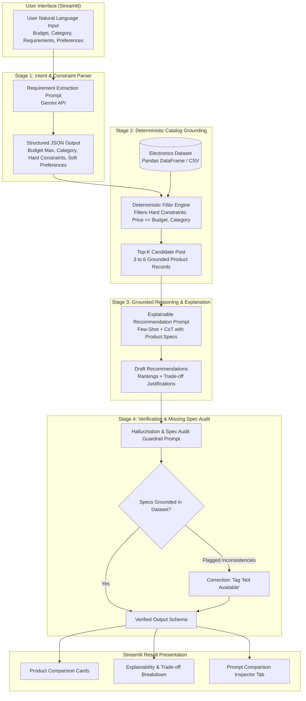

# ElectraMatch: Comprehensive Project Outline
**An Explainable, Prompt-Driven Product Recommendation System**

---

## 1. Executive Summary & Abstract
*ElectraMatch* is a prompt-engineered, grounded recommendation engine designed to assist consumers in discovering, comparing, and understanding electrical and electronic products. Unlike black-box recommendation algorithms or generic e-commerce search tools (e.g., Amazon Rufus, Google Shopping), ElectraMatch focuses explicitly on:
1. **Explainability**: Clarifying *why* a product meets the user's specific lifestyle and budget.
2. **Constraint Enforcement**: Strictly segregating non-negotiable criteria (e.g., maximum budget, appliance dimensions) from flexible preferences (e.g., preferred brand, aesthetic color).
3. **Specification Honesty & Missing Data Handling**: Refusing to hallucinate missing technical specifications, clearly flagging unknown parameters rather than guessing.
4. **Prompt Strategy Benchmarking**: Serving as an empirical study comparing Baseline (Zero-Shot), Few-Shot Structured Extraction, Chain-of-Thought (CoT) Grounding, and Verification Guardrail prompts.

---

## 2. Problem Statement & Market Context

### 2.1 The Real-World Dilemma
Purchasing electrical appliances and consumer electronics involves high cognitive load. Consumers must evaluate technical jargon (inverter compressors, energy star ratings, display refresh rates, wattage, capacity) while balancing strict financial limits. First-time buyers, students, and budget-conscious families frequently face:
- **Decision Paralysis**: Thousands of near-identical catalog entries.
- **Hidden Trade-offs**: Inability to discern whether a cheaper model sacrifices durability, energy efficiency, or key features.
- **Opaque Recommendations**: Existing recommendation engines prioritize sponsored listings or sales velocity rather than objective user constraint satisfaction.

### 2.2 Market Grounding & Statistics
- According to **KPMG's India CX Report (2025)**, over **41% of consumers** state that the pre-purchase evaluation phase is the single most critical factor influencing their appliance purchasing satisfaction.
- The primary friction points identified are feature comparability, transparent pricing, and understanding real-world utility of technical specs.

---

## 3. Project Objectives & Research Questions

### 3.1 Primary Objectives
1. **Develop an Interactive AI Assistant**: A Streamlit-based web interface where users describe requirements in conversational natural language.
2. **Implement Hybrid Filtering**: Combine deterministic Python/Pandas filtering (for non-negotiable numeric constraints like price) with LLM semantic reasoning (for nuanced trade-off explanations).
3. **Conduct Rigorous Prompt Experiments**: Quantitatively benchmark 4 distinct prompt engineering techniques on constraint compliance and hallucination mitigation.
4. **Deliver Explainable Justifications**: Produce structured rationale summaries highlighting advantages, trade-offs, and missing spec disclaimers for every recommended product.

### 3.2 Core Research Questions
- **RQ1**: Does decoupling constraint extraction into a discrete structured prompt step reduce budget violations compared to single-step zero-shot generation?
- **RQ2**: How effectively does a verification prompt prevent hallucination when crucial technical specs are missing from the dataset?
- **RQ3**: Which prompt pattern delivers the highest user satisfaction and justification clarity within token and latency constraints?

---

## 4. End-to-End System Architecture

---

## 5. Evaluation Framework & Metrics

To objectively evaluate ElectraMatch, an expanded test suite of 12 representative benchmark queries (spanning standard functional and edge/boundary cases) was compiled:
- **CCR (Constraint Compliance Rate)**: Percentage of recommendations satisfying 100% of hard criteria (budget, category).
- **MHR (Missing-Spec Hallucination Rate)**: Intercepted claims tagged as unverified vs. hallucinated.
- **BAS (Budget Adherence Score)**: Strict zero budget overshoots.
- **Empirical Baseline**: 66.7% CCR (Baseline Zero-Shot) vs. **100.0% CCR** (ElectraMatch Multi-Stage Grounded Pipeline).

---

## 6. Technology Stack

- **Frontend**: Streamlit
- **Backend & Logic**: Python 3.11+, Pandas, Pydantic
- **LLM Foundation**: Google Gemini 2.5 Flash / 1.5 Flash (via `google-genai` SDK)
- **Dataset**: Curated catalog of electrical & electronics across 8 categories with smart budget proximity scoring.
