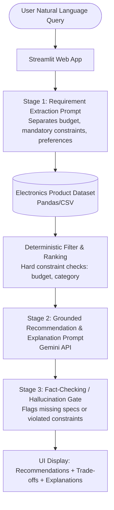

# ElectraMatch: An Explainable, Prompt-Driven Product Recommendation System

> **Summary:** ElectraMatch uses prompt engineering to understand user requirements and recommend suitable electrical and electronic products based on budget, specifications, and preferences, while identifying missing information and explaining trade-offs.

---

## Project Proposal & Form Submission Guide (Q6 – Q19)

### Question 6. Project Title and Prompt-Engineering Use Case
**ElectraMatch: An Explainable, Prompt-Driven Product Recommendation System**

> ElectraMatch uses prompt engineering to understand user requirements and recommend suitable electrical and electronic products based on budget, specifications, and preferences, while identifying missing information and explaining trade-offs.

---

### Question 7. Source of Your Problem
- **Selection:** `Self Defined`
*(Your idea is your own project concept rather than a pre-defined ID from the provided Problem Pool. Note: Check with your faculty if prior approval is required.)*

---

### Question 8. Problem ID and Source
> Self-defined — Based on my own observation that users often struggle to compare electrical and electronic products based on their needs, budget, and technical specifications. The project will explore prompt engineering for accurate, explainable, and requirement-aware product recommendations.

---

### Question 9. What is the Real-World Problem?
> Consumers often struggle to compare electrical and electronic products across online platforms because specifications, prices, and features vary. Students, families, and budget-conscious buyers may choose unsuitable products. Users will provide their budget, intended use, and preferences, and ElectraMatch will return relevant recommendations with explanations and trade-offs.

---

### Question 10. Problem Context / Background
*(Within 400 characters, includes source & statistic)*
> KPMG's India CX Report 2025 found that 41% of consumers consider the pre-purchase stage most impactful when buying large appliances. Ease of comparing features and understanding technical requirements are key considerations. ElectraMatch aims to simplify product comparison through prompt-driven recommendations.
> 
> *Source:* https://kpmg.com/in/en/insights/2025/03/india-cx-report-2025/consumer-durables/large-appliances.html

---

### Question 11. Who is Affected by This Problem?
> Students, families, working professionals and budget-conscious consumers buying electrical and electronic products are affected. They may struggle to compare prices, technical specifications, energy efficiency and features across brands. First-time buyers may find it especially difficult to identify products that match their needs and budget.

---

### Question 12. Why did your team select this problem, and why is prompt engineering relevant?
> We selected this problem because comparing technical specifications and prices can be confusing for buyers. Prompt engineering can help an AI interpret natural-language requirements, distinguish essential features from preferences, and generate structured, explainable recommendations. We will compare different prompts to evaluate recommendation accuracy and constraint compliance.

---

### Question 13. What specific tasks will your prompt or workflow perform?
> Input: User's budget, intended use, preferred features, and mandatory requirements for electrical and electronic products. The workflow extracts these requirements, filters and ranks products from a dataset, identifies missing specifications, and outputs suitable recommendations with comparisons and explanations.

---

### Question 14. Which models and tools will you use?
Select these **4 options**:
- ☑ **Gemini / Google AI Studio** — LLM for interpreting user requirements and generating explanations.
- ☑ **Custom web or mobile app** — Streamlit-based interface for user input and recommendations.
- ☑ **RAG / document grounding** — Ground recommendations in product dataset records to reduce unsupported claims.
- ☑ **Other** — Enter: `Python, Pandas and Streamlit`

---

### Question 15. Why are these models/tools suitable for your task?
> An LLM can interpret natural-language requirements and generate clear explanations. Python and Pandas can filter and rank products using structured specifications, while Streamlit provides an interactive interface. Grounding responses in dataset records helps reduce unsupported recommendations and enables evaluation of different prompts.

---

### Question 16. What inputs, documents or data will your prompts use?
> The workflow will use product datasets containing names, categories, prices, brands, and available specifications, along with users' budgets, intended use, and preferences. No personal or sensitive data is required. User inputs will be limited to product-related requirements, and any test data will be anonymized or synthetic.

---

### Question 17. What existing solutions address this problem, and what gap remains?
> Google Shopping and Amazon Rufus offer product discovery, comparisons and AI-powered recommendations. However, ElectraMatch will focus on evaluating prompt strategies for requirement extraction, strict constraint compliance and handling missing specifications using a fixed dataset.
> 
> *Sources:* 
> - https://support.google.com/googleshopping/answer/15456476
> - https://www.aboutamazon.in/news/retail/amazon-shopping-app-features-best-deals

---

### Question 18. First (baseline) prompt and one sample expected output

#### Baseline Prompt:
```text
You are a product recommendation assistant. Based on the user's budget, intended use and preferences, recommend three suitable electrical or electronic products from the provided dataset. Consider price, features and specifications. Briefly explain why each product is suitable and compare their advantages. Use the available product information.
```

#### User Input Example:
```text
I need a refrigerator under ₹25,000 for a family of three. Suggest suitable options.
```

#### Sample Expected Output (Illustrative):
```text
1. Product A — ₹22,000
   Reason: Within budget and suitable if its verified capacity meets the family's needs.
2. Product B — ₹24,000
   Reason: Within budget; compare its available energy-efficiency information.
3. Product C — ₹20,000
   Reason: Lowest upfront cost among these illustrative options.

Note: Actual recommendations must come from the dataset. If fewer than three products qualify, return fewer options. Do not invent specifications; mark unavailable details as "Not available."
```

---

### Question 19. Feedback Received from Outside the Team
*(Use if external feedback has not been collected yet)*
> External feedback has not been collected yet. We plan to seek feedback from a faculty mentor or potential users on recommendation accuracy, ease of use, and handling of missing product specifications.

---

## Planned Technical Architecture & Prompt Experiments



### Core Prompt Comparison Experiments Planned
1. **Baseline Prompt (Zero-shot)**: Standard prompt passing user text and unformatted product descriptions.
2. **Chain-of-Thought / Structured Constraint Prompt**: Explicitly separates strict constraints (e.g., Budget $\le$ ₹25,000, 3-star rating min) from soft preferences (e.g., color, brand).
3. **Grounded / Verification Prompt**: Strictly enforces no hallucination of missing technical specifications (marking them as `"Not available"`).
