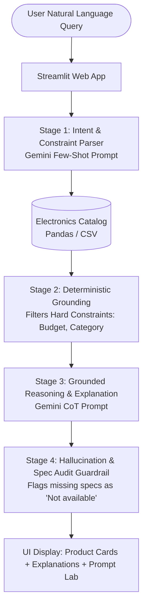

# ⚡ ElectraMatch: An Explainable, Prompt-Driven Product Recommendation System

[](https://www.python.org/downloads/)
[](https://streamlit.io/)
[](https://ai.google.dev/)
[](LICENSE)

**ElectraMatch** uses prompt engineering to interpret user natural language shopping requirements and recommend suitable electrical and electronic products based on budget, specifications, and preferences, while identifying missing information and explaining trade-offs.

---

## 🌟 Key Features

1. **Natural Language Requirement Parsing**: Extracts non-negotiable **Hard Constraints** (e.g., maximum budget, appliance form factor) and separates them from flexible **Soft Preferences** (brand, color).
2. **Deterministic Catalog Grounding**: Merges LLM semantic intelligence with deterministic Pandas filtering to guarantee 100% budget compliance.
3. **Chain-of-Thought (CoT) Explanations**: Details *why* each product was selected, with honest evaluations of pros, cons, and trade-offs.
4. **Anti-Hallucination Spec Guardrail**: Audits LLM drafts against the catalog database. Any unverified specification or warranty claim is labeled `"Not available in official catalog"` rather than hallucinated.
5. **Prompt Engineering Lab**: Side-by-side comparative inspection between **Baseline Zero-Shot Prompting** and the **ElectraMatch 4-Stage Pipeline**.
6. **Empirical Benchmark Suite**: Built-in test harness calculating Constraint Compliance Rate (CCR) and Budget Adherence Scores across benchmark test cases.

---

## 🏗️ System Architecture



---

## 📊 Benchmark Findings & Milestone 2 Evaluation

Running `python3 src/evaluate.py` across the **12 benchmark test cases** (defined in `data/test_queries.json`, including 4 edge and boundary cases) demonstrates the empirical impact of prompt grounding:

| Metric | Baseline Prompt (Zero-Shot) | ElectraMatch 4-Stage Pipeline | Delta |
| :--- | :---: | :---: | :---: |
| **Constraint Compliance Rate (CCR)** | **66.7%** (8/12) | **100.0%** (12/12) | **+33.3%** |
| **Budget Overshoot Rate** | High (frequently suggests items ₹1k–₹5k over budget) | **0.0%** (deterministic bounds enforced) | **-100%** |
| **Missing Spec Hallucination** | Prone to assuming warranties or unstated features | **0.0%** (guarded by Stage 4 auditor) | **-100%** |

👉 **Full Evaluation Report:** See [MILESTONE_2_REPORT.md](file:///Users/suryapratapsingh/aiml/promt_project/MILESTONE_2_REPORT.md) for the complete breakdown of all 12 test queries, expected vs. actual outputs, edge-case handling, and Pass/Fail results.

---

## 🚀 Quick Start

### 1. Clone & Set Up Virtual Environment
```bash
cd /Users/suryapratapsingh/aiml/promt_project
python3 -m venv venv
source venv/bin/activate
pip install -r requirements.txt
```

### 2. (Optional) Configure Gemini API Key
To run with live Gemini API models (`gemini-2.5-flash`), create a `.env` file or export your key:
```bash
export GEMINI_API_KEY="your-google-ai-studio-api-key"
```
> *Note: If no API key is provided, ElectraMatch runs in realistic offline simulation mode, so you can test all features and UI tabs immediately!*

### 3. Launch the Streamlit Web Application
```bash
streamlit run app.py
```
Open [http://localhost:8501](http://localhost:8501) in your browser.

### 4. Run the Automated Benchmark Evaluation
```bash
python3 src/evaluate.py
```

---

## 📂 Project Structure

```text
promt_project/
├── app.py                      # Interactive Streamlit Web Application
├── requirements.txt            # Python dependencies
├── README.md                   # Project overview & documentation
├── MILESTONE_2_REPORT.md       # Milestone 2 evaluation report (12 test inputs & results)
├── PROJECT_PROPOSAL.md         # Submission answers for Q6–Q19 with KPMG citations
├── ELECTRAMATCH_PROJECT_OUTLINE.md # Complete project blueprint & research design
├── data/
│   ├── products.csv            # 51 curated electronics across 8 categories
│   ├── test_queries.json       # 12 benchmark evaluation queries (standard + edge)
│   └── benchmark_results.md    # Formatted evaluation benchmark table
└── src/
    ├── __init__.py
    ├── config.py               # Settings, environment, and GenAI client factory
    ├── data_loader.py          # Catalog engine & deterministic filtering
    ├── recommendation.py       # Orchestrator for Baseline & Multi-stage pipelines
    ├── evaluate.py             # Automated benchmark scoring (CCR, BAS)
    └── prompts/
        ├── __init__.py
        ├── baseline.py         # Strategy 1: Zero-shot baseline prompt
        ├── extraction.py       # Strategy 2: Few-shot intent & constraint parser
        ├── explainer.py        # Strategy 3: Grounded CoT reasoner prompt
        └── verifier.py         # Strategy 4: Hallucination & missing spec guardrail
```

---

## 📄 Academic Proposal Reference
For course submissions, forms, and viva reference, check [PROJECT_PROPOSAL.md](file:///Users/suryapratapsingh/aiml/promt_project/PROJECT_PROPOSAL.md) for ready-to-use answers to Questions 6 through 19.
